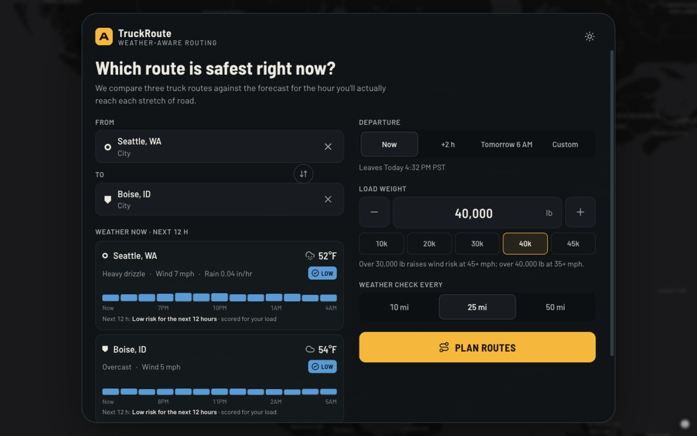
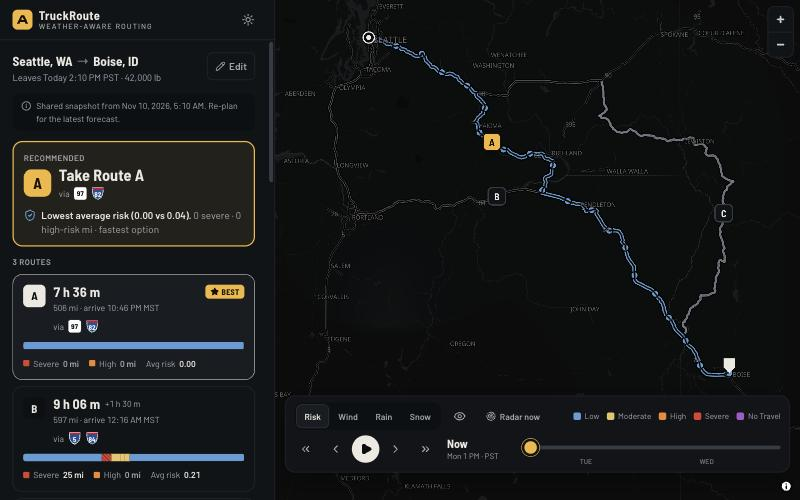
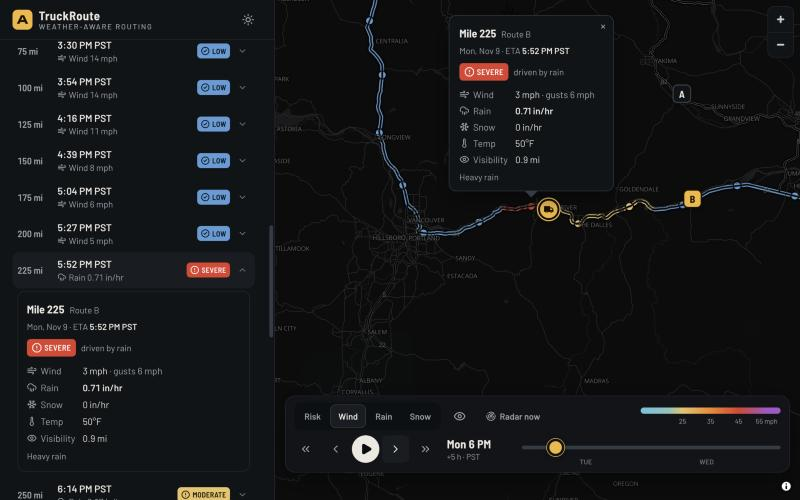
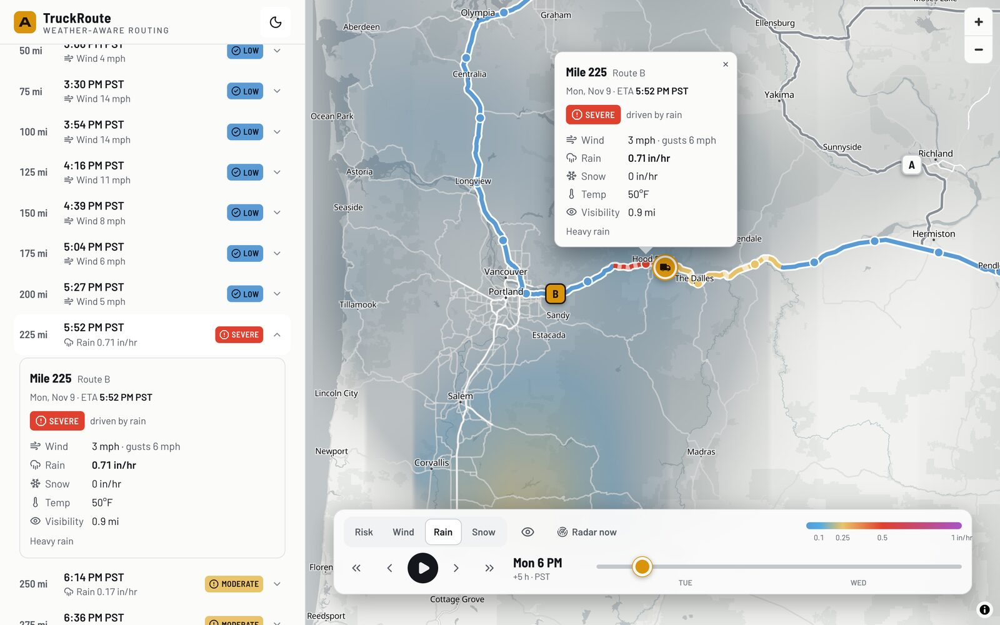
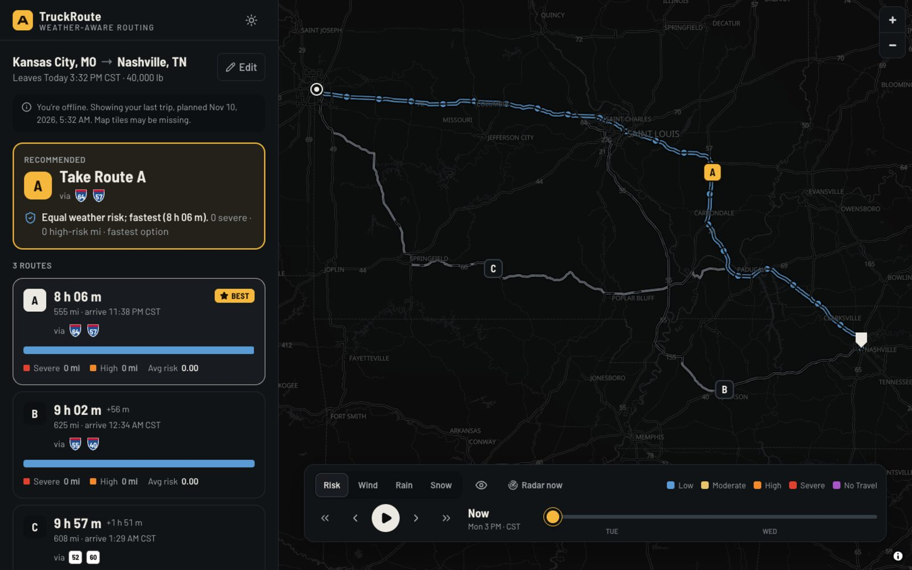
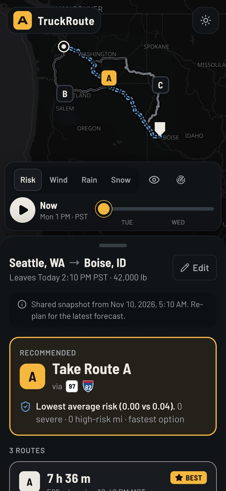
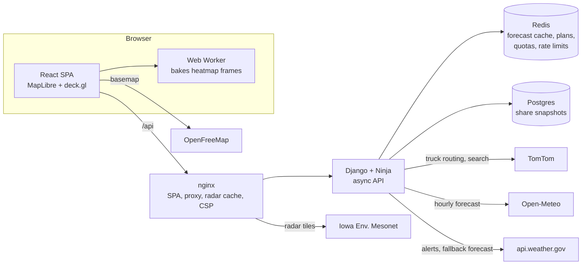

# TruckRoute: weather-aware truck routing

Pick the safest truck route for the weather, the load and the departure time.

**Live:** https://truckroute.siruyy.dev · **Example trip (shared link):** https://truckroute.siruyy.dev/t/piC-IHMBQp

TruckRoute gets three truck routes. It samples the forecast every 10, 25 or 50 miles **for the hour the truck will actually reach that point**, and scores each point with the assessment's risk and load rules. It then recommends a route and states the reason. A 0–48 h forecast slider moves a weather heatmap and a truck marker together, so a driver can see where the truck will be and what the weather will be there at the same time.

| Planner with live weather at both ends | Recommendation and route options |
|---|---|
|  |  |
| **Severe checkpoint, rain heatmap, truck at that hour** | **Light theme** |
|  |  |
| **Offline: last trip restored with the network cut** | |
|  | |

<p align="center"></p>

---

## What it does

- **Planner first.** Every visit opens on a centered planner over a softly blurred map, so the first action is entering the trip. When the plan arrives, the card morphs into the results sidebar using the View Transitions API; **Edit** morphs it back.
- **Live weather while you plan.** As soon as a start or destination is picked, the planner shows current conditions there and a 12-hour risk strip scored for your load (`GET /api/weather/point`).
- **Three truck routes.** TomTom truck routing uses the gross weight, departure time and live traffic. When TomTom returns fewer than three routes, the backend adds alternatives through via points on either side of the trip and drops near-duplicates.
- **Checkpoints at the truck's ETA.** Checkpoints sit every 10, 25 or 50 miles. Each ETA comes from TomTom's travel time along the route. The weather is the forecast hour that contains that ETA, shown in the checkpoint's local timezone.
- **Risk and load rules.** Wind, rain and snow are classified exactly per the brief, and heavy loads escalate wind risk. The checkpoint's level is the worst of the three.
- **Recommendation with a reason.** Routes are ranked by fewest No Travel miles, then Severe, then High, then average risk, then drive time. The verdict names the rule that decided it, for example *"Fewest severe-weather miles (0 vs 25)"*.
- **Trip strip.** Each route card has a bar showing risk by mile, so the answer is readable without studying the map.
- **Heatmap with a 0–48 h slider.** The map shows Risk, Wind, Rain or Snow across the trip corridor, and scrubbing is smooth (details below).
  - **Risk layer:** drawn as exact level bands. Each pixel takes the level with the most weight nearby, never a blend, so it can't show a level no rule produced.
  - **Animated weather:** the Wind layer shows particles flowing with the forecast wind (direction and speed), Rain shows falling streaks and Snow shows drifting flakes. Each appears only where that weather is forecast and follows the slider hour. With reduced motion, wind is drawn as static direction arrows instead.
  - **Hover readout:** shows the exact wind (with direction), rain, snow and level under the cursor for the slider hour.
  - **Full-area coverage:** the map is shaded across the whole area around the trip, with no gaps between routes. Near the road it blends in the checkpoints' exact forecast cells (already cached, so no extra API calls), so the map agrees with the checkpoints along the route.
  - **Timeline summary:** describes each hour in one line, for example *"This hour: all Low across the area (wind up to 12 mph)"*, so a calm map reads as calm, not empty.
- **Truck marker** that follows the slider along the selected route.
- **Better departure time.** The same routes are re-scored for leaving 1, 2, 4, 6 or 12 h later. The app suggests the safest later time, and one tap re-plans.
- **Official NWS alerts** that touch any checkpoint, such as High Wind or Winter Storm warnings. They are informational and never change the scored risk.
- **Share links** (`/t/{slug}`) that save a snapshot. **Installable PWA** that keeps the last trip offline.
- **Observed radar** (NEXRAD) toggle, clearly separate from the forecast.

### Built for drivers

- Dark theme by default, with a light theme. Tap targets are at least 48 px and body text at least 16 px.
- **Risk is never shown by color alone.** Each level has an icon, a text label, a map dash pattern and a trip-strip texture.
- The palette is an ordered ramp with no red/green pair, so it works for the most common forms of color blindness.
- Motion that explains state: the planner-to-sidebar morph, staggered result entrances, a glow on the recommendation, an animated progress bar while planning, press feedback on controls, and a shake on errors. `prefers-reduced-motion` turns all of it off.
- The phone layout uses a draggable bottom sheet and a compact timeline.

---

## How risk is decided

The rules are implemented in [`backend/risk/rules.py`](backend/risk/rules.py). Every boundary has a test in [`backend/tests/risk`](backend/tests/risk).

| Condition | Low | Moderate | High | Severe | No Travel |
|---|---|---|---|---|---|
| Wind (mph) | < 25 | 25 ≤ w < 35 | 35 ≤ w < 45 | 45 ≤ w < 55 | ≥ 55 |
| Rain (in/hr) | < 0.10 | 0.10 ≤ r < 0.25 | 0.25 ≤ r < 0.50 | 0.50 ≤ r ≤ 1.00 | > 1.00 |
| Snow (in/hr) | < 0.5 | 0.5 ≤ s < 1.0 | 1.0 ≤ s < 2.0 | 2.0 ≤ s ≤ 3.0 | > 3.0 |

**Load rules** apply to wind only:
- 45–54 mph with more than 30,000 lb is **No Travel**.
- 35–44 mph with more than 40,000 lb is **Severe**.
- 55 mph or more is **No Travel** for any load.

### Assumptions

The brief leaves these open, so these are my decisions:

1. **Band edges.** Each band includes its lower bound and excludes its upper bound. The exception is where the brief writes an inclusive range followed by a strict `>`, which applies to the top Severe band for rain and snow. Load thresholds are strict: exactly 30,000 lb does not trigger.
2. **Overall level** is the worst of load-adjusted wind, rain and snow. On ties, the reported driver is wind, then snow, then rain.
3. **Wind** uses sustained 10 m wind. Gusts are shown, and gusts of 55 mph or more add an advisory, but they don't change the level. Using gusts would make much of the country Moderate.
4. **Rain** is Open-Meteo `rain + showers`. **Snow** is `snowfall` (new snow depth). Both are sums over the preceding hour, so they are already in/hr.
5. **Time alignment.** A checkpoint reached at 3:40 PM uses the forecast row for the hour ending 4:00 PM.
6. **Miles per level.** Each checkpoint owns half of the segment on each side, so owned miles add up exactly to the route length. Severe, High and other mileage figures, and the distance-weighted average risk (Low = 0 … No Travel = 4), all come from this.
7. **Ranking.** The brief's list starts at "fewest Severe miles". No Travel is strictly worse, so it is ranked first. Ties are compared at 0.1 mi and 0.01 average risk, so float noise never decides.
8. **Load vs gross weight.** The form asks for **load** weight, as the brief does, and the risk rules use that. TomTom's `vehicleWeight` needs **gross** weight, so the backend adds a 35,000 lb tare (the `TARE_LB` setting).
9. **Departure window.** Departure must be between now and now + 48 h. Parts of a trip beyond the forecast are marked *No forecast* and excluded from the average.
10. **Better departure time.** Re-scoring reuses the original route durations, because TomTom traffic isn't re-queried, and the UI says so. Only the risk part of the ranking counts, and the suggestion must be strictly safer.

---

## Architecture



- **Backend:** Django 5.2 LTS with Django Ninja (async) and httpx. Code is split into pure domain packages with a thin API layer:

  | Package | Responsibility | I/O? |
  |---|---|---|
  | `risk/` | Rules, scoring, recommendation | No, pure |
  | `routing/` | TomTom adapter, geometry, alternatives, route naming | Yes |
  | `weather/` | Open-Meteo and NWS providers, cache, alerts | Yes |
  | `geo/` | Place search | Yes |
  | `plans/` | Orchestration, checkpoints, evaluation, grids, share model | Yes |
  | `core/` | HTTP client, Redis, quotas, errors, middleware | Yes |
  | `config/` | Settings and the API | — |

- **Frontend:** React 19, Vite, strict TypeScript, TanStack Query, Zustand and Tailwind 4. Code is organised by feature: `features/plan-form`, `features/results`, `features/map`, `features/timeline`.
- **Heatmap performance.** The API returns a lattice of up to 300 points × 49 hours. A Web Worker turns each hour into a smooth image (Gaussian-weighted, Web-Mercator-aligned) and uploads all 49 once. The slider crossfades two deck.gl `BitmapLayer`s (hour *h* and *h + 1*) through a store subscription. Scrubbing makes **no network requests and no React re-renders**.
- **Free-tier protection:**
  - Forecasts are cached on a shared 0.1° (~11 km) grid, used by both checkpoints and heatmap, for 2 h. Concurrent requests for the same cells are merged, and stale data is served if a provider fails.
  - Daily budgets cap TomTom and Open-Meteo usage, and Open-Meteo falls back to NWS when its budget runs out.
  - Per-IP rate limits use Cloudflare's client IP, with nginx `limit_req` in front.

More detail is in [docs/ARCHITECTURE.md](docs/ARCHITECTURE.md), and the original design spec is in [docs/superpowers/specs](docs/superpowers/specs/2026-11-10-weather-aware-truck-routing-design.md).

---

## Run it locally

Prerequisites: Docker. You also need a free TomTom key with Routing, Search, Geocoding and Reverse Geocoding enabled; it needs no credit card.

```bash
cp .env.example .env   # then set TOMTOM_API_KEY
docker compose up --build
```

Open http://localhost:8080. The API is on http://localhost:8000/api, with interactive docs at `/api/docs`.

### Developing without Docker

```bash
# backend (Python 3.13, uv); needs a local Redis
cd backend && uv sync && set -a && . ../.env && set +a && \
  DJANGO_DEBUG=true uv run uvicorn config.asgi:application --reload --port 8000
```

```bash
# frontend (Node 22); proxies /api to :8000
cd frontend && npm ci && npm run dev
```

### Tests and checks

```bash
cd backend && uv run ruff check . && uv run pytest --cov      # 107 tests, ~96% coverage
```

```bash
cd frontend && npm run lint && npm run typecheck && npm test && npm run build
```

Backend tests run against recorded real responses from TomTom, Open-Meteo and NWS (`backend/tests/fixtures`). Upstream calls are mocked with `respx`, and Redis with `fakeredis`.

### Verified against production

`scripts/e2e-live.mjs` (Playwright) runs four checks on the live site:
1. Plans a trip through the UI.
2. Sweeps the slider and asserts that scrubbing makes **zero** network requests.
3. Cuts the network and reloads, then asserts the last trip is restored.
4. Captures the screenshots above.

Results measured on 2026-11-10:

| Check | Result |
|---|---|
| Plan via the UI (Kansas City → Nashville, 555 mi, 3 routes) | ~4.1–4.4 s end to end, mostly TomTom truck routing |
| Slider sweep 0 → 48 h over 5 s, headed Chromium on the GPU (Apple M2 Pro, Metal), `HEADED=1` | **60 fps** average, p95 frame 18.1 ms, 0 frames over 33 ms, **0 requests** |
| Offline reload | Trip, routes, cached basemap and heatmap all restored, with the offline banner shown |
| Strong weather | Seattle → Boise at 42,000 lb: 0.71 in/hr rain in the Columbia Gorge is scored **Severe** on Route B; Route A is recommended |

---

## Deployment

- **CI:** GitHub Actions ([`.github/workflows/ci.yml`](.github/workflows/ci.yml)) lints, type-checks and tests both apps on every push. It then builds and publishes `ghcr.io/siruyy/spotter-truck-routing-{api,web}`.
- **Hosting:** production runs on a Dokploy VPS as a compose stack ([`deploy/docker-compose.prod.yml`](deploy/docker-compose.prod.yml)) behind Traefik (Let's Encrypt) and Cloudflare (Full strict).
- **Redeploy:** `deploy/redeploy.sh` pulls the new images and waits for `/api/health`.

See [docs/DEPLOYMENT.md](docs/DEPLOYMENT.md).

---

## Data sources and limits

| Service | Used for | Cost / terms |
|---|---|---|
| [TomTom](https://developer.tomtom.com) Routing and Search | Truck routes, ETAs, autocomplete | Free tier, no card. Capped at 2,000 calls/day in-app |
| [Open-Meteo](https://open-meteo.com) | Hourly forecasts | Free non-commercial, CC BY 4.0, credited in the UI |
| [NWS api.weather.gov](https://www.weather.gov/documentation/services-web-api) | Alerts; fallback forecast | Public domain |
| [IEM NEXRAD tiles](https://mesonet.agron.iastate.edu/ogc/) | Observed radar | Public domain |
| [OpenFreeMap](https://openfreemap.org) | Basemap (OpenStreetMap data) | Free, no key |

## Known limitations

- **US only.** That is where the weather sources and NWS alerts apply.
- **ETAs** come from TomTom traffic at the departure time and don't include hours-of-service rest breaks.
- **Precipitation** is model output at about 3–11 km resolution, so short, intense cells can be missed.
- **Better departure time** doesn't re-query traffic.
- **NWS fallback** rain and snow are 6-hour averages, and the UI labels them that way.
- **Offline mode** caches only the basemap tiles you have already viewed (capped at 1,500, per OpenFreeMap's terms), so unvisited zoom levels stay blank offline.

## License

[MIT](LICENSE). Third-party data keeps its own terms: Open-Meteo (CC BY 4.0), NWS and IEM (public domain), OpenStreetMap / OpenFreeMap (ODbL), and TomTom (their developer terms).
