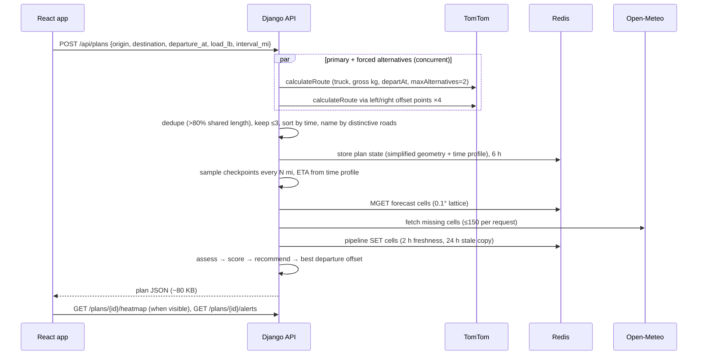

# Architecture

This note covers how a request flows and why the pieces are shaped the way they are. For the rules themselves, see the README's "How risk is decided".

## Request flow: planning a trip



The planner's conditions preview calls `GET /api/weather/point?lat&lon&hours=12&load_lb`. It reads the same 0.1° forecast cache, so previewing a place warms the cells the plan will use.

Changing the checkpoint spacing calls `GET /plans/{id}?interval_mi=` and re-samples from the stored state. It makes no routing calls.

## Backend layout

```
backend/
  config/      settings (env only), urls, api.py (Ninja: validation, errors, rate limits)
  core/        http client + retries, Redis helpers, quotas/rate limits, errors, client-IP middleware
  risk/        rules.py (classification + load rules), scoring.py (ownership miles, ranking, reason)   ← pure
  routing/     tomtom.py (adapter), alternatives.py, geometry.py, naming.py
  weather/     openmeteo.py, nws.py, service.py (cache/coalesce/fallback), alerts.py, models.py
  geo/         search.py (TomTom autocomplete + reverse geocode)
  plans/       service.py (orchestration), checkpoints.py, evaluate.py (pure), grid.py, models.py, schemas.py
  tests/       mirrors the packages; fixtures are recorded real API responses
```

Why it is shaped this way:

- **Pure core, thin edges.** `risk/` and `plans/evaluate.py` do no I/O, so the logic that carries 40% of the grade is fully unit-tested at every boundary. Adapters convert provider units into one internal model (`CellForecast`: mph and in/hr, with hour-ending timestamps).
- **Provider interface for weather.** Open-Meteo is the default. NWS is a complete second implementation, selected by configuration or used automatically when the Open-Meteo daily budget runs out or the API fails.
- **One error shape.** Every failure returns `{"error": {"code", "message"}}`. Codes are stable (`no_route`, `quota_exceeded`, `departure_in_past`, …) and messages are written for drivers.
- **Async throughout.** A single shared `httpx.AsyncClient` handles all calls, with bounded retries on 429 and 5xx. Concurrency is limited by semaphores (NWS) and by batching (Open-Meteo).

### Caching and quotas

| Data | Key | TTL | Notes |
|---|---|---|---|
| Forecast cell | `fc:{lat}:{lon}` (0.1°) | fresh 2 h, kept 24 h | Shared by checkpoints and heatmap. Concurrent requests merged in-process. Stale copy served on upstream failure |
| Plan state | `plan:{id}` | 6 h | Geometry simplified to 15 m, plus the distance→time knots |
| Autocomplete | `geo:s:{sha1}` | 24 h | |
| NWS gridpoint lookup | `nws:points:{cell}` | 30 d | |
| NWS alerts | `alerts:{cell 0.25°}` | 3 min | |
| Quotas | `quota:{provider}:{yyyymmdd}` | 2 d | TomTom hard cap. Open-Meteo switches to NWS when exhausted |
| Rate limits | `rl:{bucket}:{ip}:{minute}` | 2 min | IP taken from `CF-Connecting-IP` |

## Frontend layout

```
frontend/src/
  api/         typed client, wire types, TanStack Query hooks
  store/       Zustand UI state (selected route, slider hour, layer, theme, sheet)
  lib/         time (zones, formatting), geo (track interpolation, risk segments), risk palette, persistence
  components/  RiskChip, Segmented, RoadShield (interstate/US shields)
  features/
    plan-form/ PlaceInput (accessible combobox), DepartureField, LoadField, PlanForm
    results/   Verdict, RouteCard + TripStrip, CheckpointList/Details, DepartureTip, AlertsPanel, ResultsPanel
    map/       MapView (MapLibre layers), HeatmapOverlay (deck.gl), TruckMarker, heatmap/ (worker + baking)
    timeline/  TimeSlider, Legend
  app/         App shell (desktop side panel / mobile bottom sheet), HowItWorks
```

### Keeping the slider at 60 fps

1. **Payload.** The heatmap payload is hour-major arrays: `layers.risk[h * points + p]`. Risk uses the trip's load weight.
2. **Baking.** `heatmap/bake.worker.ts` computes, once per (heatmap, layer), per-pixel Gaussian weights to nearby lattice points. Each hour is then a weighted sum per pixel, colored with a fixed ramp. Rows are laid out linearly in Web Mercator Y, so the image lines up with the basemap. The result is 49 `ImageBitmap`s, transferred to the main thread without copying.
3. **Drawing.** `HeatmapOverlay` subscribes to the store's `hour`, outside React. On each animation frame it sets two `BitmapLayer`s, frames ⌊h⌋ and ⌊h⌋ + 1, with opacity equal to the fractional part.
4. **Truck marker.** It uses the same subscription pattern: ETA → mile (interpolated between checkpoints) → point along the drawn line.

Dragging the slider therefore makes no network requests and no React re-renders of the map or panels.

### Planner-to-results morph

The planner card and the results sidebar (or the mobile bottom sheet) share `view-transition-name: planner`. Only one of them carries the name at a time. `lib/viewTransition.ts` wraps the state change in `document.startViewTransition` with `flushSync`, so the browser morphs one box into the other while the map resizes and fits the routes.

The update is applied immediately in three cases: without View Transitions support, with reduced motion, or in a hidden tab. If the browser hasn't started the transition within 400 ms, it is skipped and the update applied, so the UI can never wait on an animation.

### Map layering

The heatmap and radar sit **below** the route lines, and route lines sit below the basemap's labels. The app inserts its layers before the style's first symbol layer, and deck.gl runs in interleaved mode.

## Security notes

- The TomTom key only lives in the API container's environment. The browser talks only to the app's own origin.
- nginx sends a strict CSP: same-origin scripts, plus OpenFreeMap tiles. Other headers: `X-Frame-Options: DENY`, `nosniff`, a Referrer-Policy, and a Permissions-Policy that allows geolocation for this site only.
- All inputs are validated with pydantic at the boundary: coordinates limited to the US, load 0–50,000 lb, departure within now…+48 h, spacing ∈ {10, 25, 50}, and an alphanumeric share slug.
- Containers run as non-root (API). Postgres and Redis are not published, and production secrets are stored only in Dokploy's environment.
